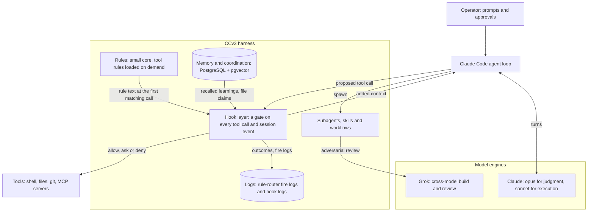

# CCv3: a governed agent harness for Claude Code

CCv3 is a harness that wraps every Claude Code session. It adds hooks, rules, memory, agents,
guardrails and observability around the model. The model proposes each action. The harness
decides if the action runs, gives the model only the context it needs, and records the result.

CCv3 started from the MIT-licensed
[parcadei/Continuous-Claude-v3](https://github.com/parcadei/Continuous-Claude-v3). Of the
1,441 commits on `main`, 92 come from the upstream author and 1,177 are authored as Rev4nchist.

Status: one operator uses CCv3 every day on a Windows 11 machine. The install path was verified
on a second machine on 2026-10-24 (PR #147). It is a development harness for one person. It is
not a multi-user product.

## At a glance

All counts were measured on 2026-10-26 at commit `1db5a6c7`.

| Count | Value | What it counts |
|---|---|---|
| Commits on `main` | 1,441 | All commits since the first commit on 2026-01-10 |
| Commits authored as Rev4nchist | 1,177 | `git log --author=Rev4nchist` |
| Commits from the upstream base | 92 | `git log --author=parcadei` |
| Merged pull requests | 147 | "Merge pull request" commits on `main` |
| Hook programs | 73 | TypeScript files at the top level of `.claude/hooks/src/` |
| Live hook registrations | 75 | Entries across 67 hook names, counted by `hook-contract-guard.mjs` |
| Hook test files | 101 | `.claude/hooks/src/__tests__/*.test.ts` |
| Subagent definitions | 35 | `.claude/agents/*.md`: 12 on `opus`, 23 on `sonnet` |
| Skills | 80 | Folders in `.claude/skills/` that hold a `SKILL.md` |
| On-demand rules | 20 | `.claude/rules-ondemand/*.md`, loaded by the `rule-router` hook |
| Always-loaded instructions | 23,502 chars | Core plus this repo's `CLAUDE.md` chain. Core alone was 18,275 after PR #57, down from 153,689. |

## The harness shape



The model proposes and the harness decides. Each tool call goes through the hook layer before it
runs. A hook can allow the call, ask the operator, or deny it with a reason. Hooks also add
context: a rule at the first call that needs it, or a stored learning that matches the prompt.
After the call, hooks record outcomes and log lines. The model sees only the context the
task needs, and every decision leaves a record.

## The layers

Each layer below lists what it does, how it works, and one measured result.

### 1. Hooks

Hooks are small programs that Claude Code runs at lifecycle events. They gate tool calls, add
context and record state.

- Source is TypeScript in `.claude/hooks/src/`. `npm run build` in `.claude/hooks` bundles each
  file with esbuild to `.claude/hooks/dist/*.mjs`. Only the bundles run.
- `settings.json` registers hooks on events such as `SessionStart`, `UserPromptSubmit`,
  `PreToolUse`, `PostToolUse`, `PreCompact`, `Stop` and `SessionEnd`.
- A hook speaks to the model only through the `hookSpecificOutput` field. Shared helpers in
  `.claude/hooks/src/shared/output.ts` write that shape.
- A registration has two gates: the `settings.json` matcher and the hook's own `tool_name` check.
  Both must agree, or the hook never acts.

Measured result: 16 hooks exited 0 and never reached the model. They wrote `result` or `message`
fields, which Claude Code does not read. Commit `fd906dd` fixed them.
`scripts/hooks/hook-contract-guard.mjs` now fails on any discarded output. Its current output:
`75 live entries / 67 names, 67 sources scanned, 45 speak the contract, 0 discarded-output`.

### 2. Rules

Rules are the instruction text the model reads. CCv3 keeps the always-loaded part small and loads
the rest when it applies.

| Tier | Source in the repo | When it loads |
|---|---|---|
| Core | `.claude/templates/CLAUDE.md.template`, installed as `~/.claude/CLAUDE.md` | Every session |
| On demand | `.claude/rules-ondemand/*.md` and `.claude/rules-ondemand/manifest.json` | At the first matching tool call |
| Path-scoped | `.claude/rules-src/*.md` with `paths:` frontmatter | When matching files are in use |

- The `rule-router` hook (`.claude/hooks/src/rule-router.ts`) reads `manifest.json`. Each entry
  maps a command, agent, skill or MCP tool to one or more rule files.
- Mode `deny-first` refuses the first matching call and gives the rule text as the reason. The
  model then re-plans with the rule in view. This mode is for rules that must change a decision,
  for example a commit message.
- Mode `inject` adds the rule text as context and lets the call run.
- The router logs every fire to `~/.claude/logs/rule-router.jsonl`. It fails open: on an internal
  error, the call runs.
- `scripts/rules/context-budget-guard.mjs` counts the same files Claude Code loads. It fails when
  the total passes `maxChars` in `scripts/rules/context-budget.json`. After a cut, `--repo --tighten`
  lowers `maxChars` to the total plus a 300-char reserve.

Measured result: always-loaded text fell from 153,689 to 18,275 characters. The work landed in
PRs #57 to #61 on 2026-09-24. Commit `ccfc2ef` replaced the old core files and 10 always-loaded
rules with one approved core file.

### 3. Memory

Memory keeps learnings across sessions and recalls them by meaning.

- PostgreSQL 16 with pgvector runs in Docker (`docker/docker-compose.yml`). The schema in
  `docker/init-schema.sql` has four tables: `sessions`, `file_claims`, `archival_memory` and
  `handoffs`.
- `opc/scripts/core/store_learning.py` stores typed learnings, for example `WORKING_SOLUTION`,
  `FAILED_APPROACH` and `USER_PREFERENCE`.
- `opc/scripts/core/recall_learnings.py` runs a hybrid search. It fuses full-text rank and
  pgvector cosine rank with Reciprocal Rank Fusion. A local BGE model makes the embeddings.
- Hooks use memory at set points. `memory-awareness` matches each prompt. `pre-plan-memory` runs
  before plan mode. `agent-recall-injector` briefs each subagent. `session-end-extract` stores
  learnings when a session ends.

Measured result: project-scoped recall never worked from the documented call site. It hashed the
working subdirectory, not the project root, and fell back to global rows without a warning.
Commit `92600ef` fixed the scope. A stored handoff that recall did not return before now ranks
first.

### 4. Agents and coordination

Subagents take delegated work. A coordination layer in PostgreSQL stops parallel sessions from
colliding.

- `.claude/agents/` holds 35 agent definitions, each with a `.json` sidecar. Each pins its model:
  `opus` for judgment (planning, review, orchestration) or `sonnet` for execution.
- `scripts/check-agent-model-drift.mjs` fails on a missing model, on `haiku` or `inherit`, or on
  a sidecar that disagrees with its `.md` file.
- Workflow skills such as `/build`, `/fix`, `/explore` and `/maestro` chain agents. The `maestro`
  agent (opus) picks a pattern. The `kraken` agent (sonnet) implements.
- `scripts/coordination/lane.mjs` lets a session claim a lane (a named unit of work). The claim is
  atomic and has a lease. The `lane-context` hook shows the lane board inside each session.
- The `file-claims` hook runs before each Edit or Write. It denies an edit to a file that another
  live session holds.

Measured result: the file lock failed open under load. The old transport started a Python
process for each check. When that process timed out, callers read "no claim". Commit `d4ecead`
moved the check to a direct `node-pg` connection. `scripts/coordination/load-probe.mjs` measured
6 of 60 intruders let through before, and 0 of 240 after (2026-07-26). The result depends on
machine health, so the probe now measures process-spawn latency first. On a slow machine it
reports INCONCLUSIVE, not a verdict.

### 5. Guardrails

Guardrails stop risky actions before they run.

- `destructive-command-guard` checks Bash and PowerShell calls.
  `.claude/hooks/src/shared/destructive-classifier.ts` classifies the command after it removes
  quoted text. An interactive session gets `ask`. An
  unattended session gets `deny`, because a prompt would hang a headless run.
- `coderabbit-guard` checks the CodeRabbit CLI. It caps runs at 2 per branch and blocks billing,
  key, autofix and install commands. It is built and tested but not registered in live settings
  yet (DW-80).
- `package-install-guard` checks each install command. It checks a typosquat list, a
  known-malicious list that a scheduled job updates, OSV.dev advisories and package age. A package
  under 24 hours old is blocked.
- `plan-mode-approval-gate` asks for approval before a session leaves plan mode.
- `agent-model-guard` denies a spawn of an agent that has no definition. `no-haiku-enforcer`
  denies a spawn on `haiku`, and any spawn while a global model override is set.
- The `rule-router` `deny-first` mode puts the matching safety rule in front of the model before
  a paid API run, or a commit message.

Measured result: four hooks named PowerShell in their matcher but rejected it at runtime. Only
one of the two gates was widened, so the hooks never ran. Commit `164d86a` fixed all four. The
new test `.claude/hooks/src/__tests__/hook-matcher-runtime-consistency.test.ts` found 7
violations before the fix and 0 after.

### 6. Observability

Observability records what each session did and makes failures visible.

- Braintrust tracing was retired on 2026-09-30. Sessions keep their local transcripts under
  `~/.claude/projects/`. The old tracing code is in `archive/braintrust-2026-10/`.
- `rule-router` logs each fire. A weekly scheduled audit
  (`scripts/scheduled-rule-router-audit.bat`) checks rule precision.
- The `/health-check` skill runs `opc/scripts/health_check.py`. It exercises the real code path
  in 13 categories, such as memory and hooks. It does not only check that files exist.
- `apps/agentic-os/` is a Next.js dashboard over the session and lane tables.
- Scheduled jobs write a `Failed` row before their long step and update it after. A killed run
  leaves a record, not a gap (commits `f43755e` and `4f5f38b`).

Past result (Braintrust tracing, now retired): the session-end trace flush was a blocking HTTPS
call. It took 30.97 s against a 10 s budget, so Claude Code cancelled it and lost the batch.

A second result: `/health-check` reported "PASS: 0 hook registrations all resolve" while 85 hooks
were live. Its parser read only one of two registration shapes. Commit `ee29181` fixed the parser.

### Self-improvement

The harness reviews itself on a schedule and turns findings into pull requests.

- `scripts/self-improvement/run-research.ps1` runs each day. It picks the next of 12 components
  from `scripts/self-improvement/components-manifest.json`. A headless session researches it and never edits code. It
  writes a cited proposal to `docs/self-improvement/proposals/` with an ADOPT, WATCH or SKIP
  verdict. The loop started in
  commit `ccbc67e` (2026-06-30).
- Each correction from the operator becomes a stored learning (`USER_PREFERENCE` or
  `FAILED_APPROACH`), so the next session recalls it.
- A weekly audit checks rule-router precision (PR #60). Rules that fire on the wrong command go
  to a capture log for a weekly review (PR #62).
- A deep evaluation on 2026-09-23 produced 7 merged pull requests, #45 to #51.

Measured result: PR #53 set the rule that a test must fail when its behaviour breaks. PR #54
then audited all 109 hook test files. It deleted 11 files and 290 tests that could not catch a
bug, which left 98 files. For each deletion, the audit broke the target code and saw the test
stay green, or it confirmed the target was dead code.

### Pull request review and CI

Each pull request to `main` passes automated checks before the operator merges it.

- Greptile reviews every pull request (`.greptile/config.json`).
- CodeRabbit reviews a pull request only when it carries the `review:coderabbit` or
  `review:deep` label (`.coderabbit.yaml`). The `coderabbit-guard` hook, not yet registered live,
  caps CLI runs at 2 per branch.
- `scripts/github/review-status.mjs` prints READY only when Greptile reviewed the current head,
  any required CodeRabbit review is on that head, no review thread is open and all checks pass
  (`.claude/rules-ondemand/pr-review-loop.md`).
- `scripts/github/land-pr.ps1` merges a ready pull request and syncs `~/.claude` from a
  temporary worktree of `main`, so another session's branch cannot leak into the sync.
- GitHub Actions run two checks: a full-history gitleaks scan and the no-work-user ratchet.
  A gitleaks pre-commit hook (`.githooks/pre-commit`) catches secrets before the commit.

The operator merges. No tool merges without the operator's yes.

Measured result: Windows hook spawns opened a visible terminal and took keyboard focus. With
`detached: true`, Windows ignores `windowsHide`. PR #148 added `lib/spawn-hidden.ts`, a small
relay that runs the command under a hidden console. A WinEvent trace showed the old shape created
and focused a Windows Terminal window, and the new shape created only a hidden console.

## Multi-agent communication

Agents and sessions exchange work through typed channels, not chat copy-paste.

| Channel | Between | Mechanism | Where |
|---|---|---|---|
| Subagent spawn | A session and a subagent | Agent tool, pinned model, memory brief | `.claude/agents/`, `agent-recall-injector` hook |
| Workflows | An orchestrator and its workers | Parallel research, synthesis, adversarial check | `/maestro`, `/build`, `/premortem` skills |
| Lanes and messages | Parallel sessions | Lanes, leases and direct messages in PostgreSQL | `scripts/coordination/lane.mjs` |
| File claims | Parallel sessions | A lock checked before each edit | `file-claims` hook |
| Cross-model review | Claude and Grok | A second model family reviews diffs and plans | `grok-adversary` agent, `/premortem --grok` |
| Handoffs | A session and the next session | Typed record with an outcome | `/create_handoff`, `/resume_handoff` skills |
| Assistant bridge | A Claude.ai work assistant and Claude Code | Rows in a shared Notion database | `notion-bridge` skill |

**Two-tier model policy.** Each subagent pins `opus` or `sonnet` in its frontmatter. Judgment
work (planning, review, orchestration, forensics) goes to `opus`. Execution goes to `sonnet`.
The drift gate and the `no-haiku-enforcer` hook hold the policy.

**Workflows.** A workflow runs independent read-only investigations in parallel. A synthesis step
merges them. Adversarial reviewers then attack the result. In July 2026 this pattern decided to
repair the harness rather than rebuild it. Two investigations were refuted by their own
adversary before the plan shipped (`docs/harness-strategy/2026-07-28-plan-repair-with-ratchet.md`,
from the handoff in commit `b8f24d3`).

**Lanes and file claims.** Several Claude Code sessions work on one branch at once. Each session
claims a lane before it starts work. `lane.mjs` identifies a session by `CLAUDE_CODE_SESSION_ID`,
so two sessions never share one identity. `lane.mjs say` and `lane.mjs inbox` carry direct
messages between live sessions. The `file-claims` hook blocks edits that collide.

**Cross-model review.** Grok reviews a diff or a plan from a different training family.
`grok-worker` builds. `/premortem --grok` is the optional adversarial pass. The Codex
integration was removed in PR #146 (2026-10-23).

**Typed handoffs.** A session that cannot finish writes a handoff. Each handoff records an
outcome: `SUCCEEDED`, `PARTIAL_PLUS`, `PARTIAL_MINUS` or `FAILED`. `/resume_handoff` restores the
context in a new session. The `session-end-handoff-indexer` hook indexes handoffs into memory.

**Assistant bridge.** A Claude.ai work assistant and Claude Code share one Notion database of
handoff rows (PR #55). Each row has `From`, `To`, `Status`, `Priority` and `Outcome`. The sender
writes the row. The receiver changes its status. A database view cannot miss a row, so no
handoff depends on a manual step.

## Engineering principles

| Principle | What it means here |
|---|---|
| Done means proven | A change is done only when an end-to-end check passes and its output is saved. A unit test alone is not proof (`AGENTS.md`). |
| No vacuous gates | A gate asserts a non-zero count of things it checked. A scan that finds nothing fails. See the header of `scripts/hooks/hook-contract-guard.mjs`. |
| Ratchets | A gate records a baseline and fails if the number gets worse. Examples: `scripts/rules/context-budget.json`, `scripts/hooks/suite-count-ratchet.mjs`. |
| Fail closed on risk | Destructive and unattended actions get `ask` or `deny`. A guard's own internal error fails open, so one guard bug cannot stop all work. |
| A hook block is a finding | A block names a real problem. Sessions do not route around it with another tool or a wrapper. |
| Confirm first | Deletes, history rewrites, schema changes, deploys, sends and paid runs need the operator's approval. |
| One canonical source | The repo is the source. `scripts/sync-to-active.sh` copies it to `~/.claude` after each commit. |
| Review every change | Each pull request gets an automated Greptile review (`.greptile/config.json`). A review label adds CodeRabbit. `scripts/github/review-status.mjs` gates READY. Fixes cite the review, for example `(Greptile #113)`. |
| Portable by profile | Machine paths and the skill skip list live in `machine/personal.json`. A ratchet and a CI job fail if a work-machine path returns. |

The forward sync has a clobber guard. It keeps a sha256 manifest of each file it wrote. If the
active copy changed since the last sync, the script moves that copy to a quarantine folder
before it overwrites it.

## Repository map

| Path | What it holds |
|---|---|
| `.claude/hooks/` | Hook sources (`src/`), bundles (`dist/`), tests (`src/__tests__/`) |
| `.claude/rules-src/` | Path-scoped rules and the always-loaded index of on-demand rules |
| `.claude/rules-ondemand/` | 20 tool rules and the `manifest.json` that routes them |
| `.claude/templates/` | The core `CLAUDE.md` template and other install templates |
| `.claude/agents/` | 35 subagent definitions, each as `.md` plus a `.json` sidecar |
| `.claude/skills/` | 80 skills, each in its own folder with a `SKILL.md` |
| `.claude/settings.json` | Hook registrations, the repo copy |
| `opc/` | Python: the setup wizard (`opc/scripts/setup/`), memory scripts (`opc/scripts/core/`) and their tests |
| `scripts/` | Gates, probes, sync, coordination, self-improvement and scheduled jobs |
| `machine/` | The personal machine profile. Settings render from it and the settings template. |
| `.github/workflows/`, `.githooks/` | CI checks (gitleaks, no-work-user) and the commit hooks |
| `docker/` | PostgreSQL + pgvector compose file and schema |
| `apps/agentic-os/` | Next.js dashboard over session and lane data |
| `docs/` | Architecture notes, harness strategy, research and self-improvement proposals |
| `tests/workflow-tests/` | Checks for new workflows, skills and integrations |
| `e2e/` | A Playwright placeholder. It does not test this repo. |
| `ai-report-card/`, `proofs/`, `tasks/` | A weekly report generator, Lean proofs for the optional math tools, and the task lists |

Start with these root files: `CLAUDE.md` (repo rules), `AGENTS.md` (testing), `CONTEXT.md` (the
glossary) and `BOOTSTRAP.md` (full setup). `.coderabbit.yaml` configures the label-gated
CodeRabbit review.

## Getting started

The reference machine runs Windows 11. The wizard has install paths for macOS and Linux, but
the harness is tested on Windows only.

### Prerequisites

| Tool | Check |
|---|---|
| Claude Code | `claude --version` |
| Docker Desktop | `docker --version` |
| Node.js 18 or later | `node --version` |
| Python 3.12 or later | `python --version` |
| uv | `uv --version` |
| Git | `git --version` |

### Install

1. Clone the repo. It is private, so you need GitHub access first.

   ```bash
   git clone https://github.com/Rev4nchist/Continuous-Claude-v3.git continuous-claude
   cd continuous-claude
   ```

2. Rename the remotes. Scheduled scripts expect `fork` for this repo and `origin` for upstream.

   ```bash
   git remote rename origin fork
   git remote add origin https://github.com/parcadei/Continuous-Claude-v3.git
   ```

3. Run the setup wizard.

   ```bash
   cd opc
   uv run python -m scripts.setup.wizard --profile personal
   ```

   The wizard backs up `~/.claude` first. It then starts the PostgreSQL container, builds the
   hooks, installs skills, agents and rules into `~/.claude`, and writes `settings.json`. It also
   installs the post-commit hook that runs the forward sync. Settings render from
   `.claude/settings.json.template` plus the profile in `machine/personal.json`. Edit the profile
   paths for your machine first. The `--profile personal` flag selects the profile and saves the
   choice, so later syncs use it too. `BOOTSTRAP.md` does not yet cover this step.

4. Open a new terminal, so the new environment variables load.

5. Verify the install from the repo root.

   ```bash
   bash scripts/verify-setup.sh
   ```

   You should see `Setup looks good!` and `Failed: 0`. The script fails if the third-party
   `archify` skill is missing. `BOOTSTRAP.md` shows how to install it.

### Windows notes

- Run the `.sh` scripts in Git Bash. On some machines `bash` on the PATH is WSL.
  `scripts/sync-to-active.sh` refuses to run under WSL, because it would sync the wrong home
  folder.
- Use `python`, not `python3`. Set `PYTHONUTF8=1` as a user environment variable.
- `BOOTSTRAP.md` covers GitHub identity for a machine with two GitHub accounts. The wizard does
  not do this step.

## Testing and gates

A change is done when its end-to-end check passes and the output is saved. The check depends on
what you changed (`AGENTS.md`).

| You changed | Run this |
|---|---|
| A hook | `npm run build` in `.claude/hooks`, then pipe a real payload into the bundle: `Get-Content payload.json -Raw \| node .claude/hooks/dist/<hook>.mjs` |
| The sync script | `bash scripts/sync-to-active-cursor.test.sh` (runs the real script in a temporary home) |
| Coordination | The matching `scripts/coordination/*-probe.mjs` |
| A rule, skill or agent | After the sync, `claude -p "<prompt>" --output-format json`, then confirm the new behaviour |

Save each artifact to `.claude/cache/e2e/<YYYY-MM-DD>-<name>.<ext>`. That folder is gitignored.
Name the file in the pull request's Evidence section.

Isolated tests cover only logic that an end-to-end check cannot reach cheaply: parsers, regexes,
guards and date math. Hook tests use vitest (`npm test` in `.claude/hooks`). Python tests use
pytest in `opc/`. A bug fix starts with a test that reproduces the bug.

Static gates:

| Gate | Command | Output on 2026-10-26 |
|---|---|---|
| Context budget | `node scripts/rules/context-budget-guard.mjs --repo` | `always-loaded: 5 files, 23502 chars (budget 23516, Claude Code limit 150000) [repo]` |
| Hook output contract | `node scripts/hooks/hook-contract-guard.mjs` | `PASS ... 75 live entries / 67 names ... 0 discarded-output, 2 known-debt, 8/8 timers safe` |
| Model policy | `node scripts/check-agent-model-drift.mjs .` | `agents: 35 \| opus: 12 sonnet: 23 \| OK` |
| Skills | `node scripts/skills/audit-skills.mjs` | `80 skills, 0 hard failures, 0 ratchet regressions` (rules G01-G32) |
| Test suite size | `node scripts/hooks/suite-count-ratchet.mjs` | Fails if passed or collected tests drop below the baseline |

The context budget has 14 characters of headroom, so the next rule edit needs a deliberate budget change.
The `--repo` budget counts more files than a normal session loads. It adds this repo's own
`CLAUDE.md` chain, because sessions that work on the harness load both sets.

`scripts/coordination/load-probe.mjs` writes test rows to the coordination tables. Run it only
against a development database.

`npm run test:e2e` at the root runs only `e2e/example.spec.ts`, a placeholder.

## Related work

FourthBot is a separate repository. It applies the same harness shape to agents for Fourth's
business teams. It has a policy gateway that fails closed with allow, ask and deny. It has an
append-only event log of what the model sees, and human approval steps with a database guard
against double decisions. Its bots hand work to each other on a bot-to-bot (A2A) bus, with a
receipt for each handoff. It targets Fourth's Azure tenant with Entra sign-in. Today it runs on a
local Docker Compose stack.

## Credits and license

CCv3 is a fork of [parcadei/Continuous-Claude-v3](https://github.com/parcadei/Continuous-Claude-v3)
and includes work from its contributors. The upstream base and this fork are under the MIT
License, Copyright (c) 2026 Cosimo Streppone. See `LICENSE`.

The fork's harness work (hooks, gates, rule routing, coordination, observability and the
self-improvement loop) is by Dave Hayes (GitHub: Rev4nchist).
