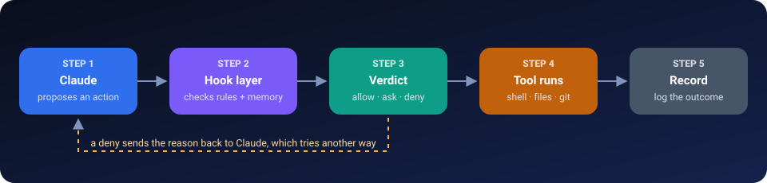
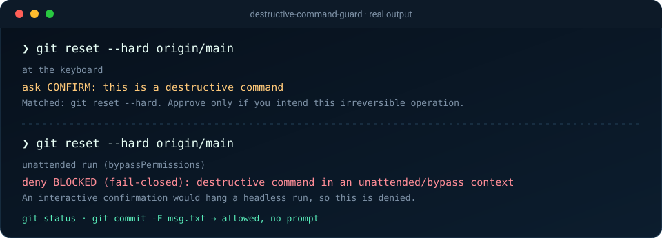
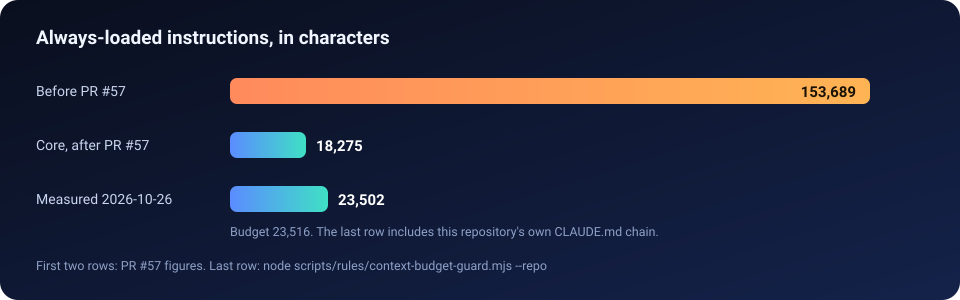

<h1 align="center">
  <picture>
    <source media="(prefers-color-scheme: dark)" srcset="docs/assets/readme/banner-dark.svg">
    
  </picture>
</h1>

<p align="center">
  <a href="#why-a-harness">Why</a> ·
  <a href="#see-it-work">How it works</a> ·
  <a href="#the-six-parts">The six parts</a> ·
  <a href="#what-you-gain">What you gain</a> ·
  <a href="#proof">Proof</a> ·
  <a href="#getting-started">Install</a> ·
  <a href="#go-deeper">Go deeper</a>
</p>

<p align="center">
  
  
  
  
</p>

**An AI coding agent is fast, and it acts without asking.** CCv3 puts a checkpoint around every action Claude Code takes. The checkpoint stops dangerous commands. It loads only the rules a task needs. It records every decision.

> [!NOTE]
> CCv3 is a development harness built for one operator on Windows 11. The install path was verified on a second machine on 2026-10-24 (PR #147). It is not a multi-user product.

## Why a harness

An agent that works well in one session can still fail in the next three ways.

- **It repeats mistakes.** A 30-day audit of this repository found 38 corrections in four classes that came back again and again: skipped verification (12), wrong format (6), wrong target (5) and misread request (3). About 85% of the audited turns were automated prompts. For interactive turns the rate is nearer 6 corrections per 100 ([audit](docs/self-improvement/audits/2026-08-19-failure-modes.md)).
- **It over-reaches.** One wrong `git reset --hard` or recursive delete can erase hours of work in a single call.
- **It claims success.** "Done" arrives with no test run and no output. Skipped verification was the top correction class: 12 of the 38.

> [!TIP]
> The fix is not a smarter prompt. It is a checkpoint that runs outside the model, so the model cannot talk its way past it.

## The one idea

**The model proposes. The harness decides.**

Claude Code still does the work. CCv3 sits between Claude and your machine. Each tool call goes through a **hook**: a small program that runs before the call. The hook can allow the call, ask you, or deny it with a reason. After the call, hooks record what happened.

## See it work

<p align="center">
  
</p>

1. **Claude proposes** an action, for example `git reset --hard origin/main`.
2. **The hook layer** checks the command against the rules. A rule loads only when a call needs it.
3. **A verdict comes back:** allow, ask or deny.
4. **The tool runs** only if the verdict allows it. On a deny, Claude gets the reason and picks another way.
5. **The outcome is recorded.** Hook logs show how often each guard fires.

Here is the real output of the destructive-command guard for that command:

<p align="center">
  
</p>

*Unattended run (bypassPermissions): BLOCKED. When you are at the keyboard, the guard asks first.*

<details>
<summary>Reproduce this output</summary>

Build the hooks first (`npm run build` in `.claude/hooks`). Then feed the guard a real tool-call payload:

```bash
echo '{"hook_event_name":"PreToolUse","tool_name":"Bash","tool_input":{"command":"git reset --hard origin/main"}}' | node .claude/hooks/dist/destructive-command-guard.mjs
```

You should see a JSON reply with `"permissionDecision":"ask"`. Add `"permission_mode":"bypassPermissions"` to the payload to see the unattended `deny`. Source: [destructive-command-guard.ts](.claude/hooks/src/destructive-command-guard.ts).

The guard counts bypass mode, subagent runs (`CLAUDE_AGENT_ID`) and CI as unattended. A plain headless `claude -p` run is not detected, so it gets `ask`. The guard also lets a call through if it hits a parse error. It is a backstop, not a sandbox.

</details>

## The six parts

| Part | Its job | Example | What you gain |
|---|---|---|---|
| **[Hooks](docs/harness/layers.md#1-hooks)** (73 programs) | Run code before and after every tool call | Ask before `git reset --hard` | Unsafe actions stop before they run |
| **[Rules](docs/harness/layers.md#2-rules)** (20 on demand) | Tell the model how to behave, in small pieces | A commit-style rule loads only when you commit | A small always-loaded core |
| **[Memory](docs/harness/layers.md#3-memory)** | Keep lessons and session state in PostgreSQL, outside the chat | A stored lesson survives a restart | Work does not vanish with the session |
| **[Agents](docs/harness/layers.md#4-agents-and-coordination)** (35 subagents) | Hand work to specialists. Judgment runs on opus, execution on sonnet. | A scout reads many files so the main chat stays short | Parallel work without a crowded context |
| **[Guardrails](docs/harness/layers.md#5-guardrails)** | Scan for secrets, check package installs, run CI | gitleaks runs before each commit and again in CI | Secrets and risky installs are caught early |
| **[Observability](docs/harness/layers.md#6-observability)** | Log hook decisions and rule loads | A log shows a rule that fired when it should not | The harness can be measured and fixed |

## What you gain

| You get | Because | Evidence |
|---|---|---|
| **Safer sessions** | Guards run outside the model. In bypass mode, in a subagent or in CI, the destructive-command guard denies instead of asking | [destructive-command-guard.ts](.claude/hooks/src/destructive-command-guard.ts), [hook-contract-guard.mjs](scripts/hooks/hook-contract-guard.mjs) |
| **Lean context** | A small core loads every time. Tool rules load on demand. | [context-budget-guard.mjs](scripts/rules/context-budget-guard.mjs), chart below |
| **"Done" means proven** | Each change needs an end-to-end check with saved output | [AGENTS.md](AGENTS.md) |
| **Reviewed changes** | Every pull request passes CI: semgrep, trivy, gitleaks and the ratchets. Greptile reviews only on request. CodeRabbit joins when a label asks for it. The current READY rule is in [Pull request review and CI](docs/harness/review-and-ci.md). | [review-status.mjs](scripts/github/review-status.mjs), [.greptile/config.json](.greptile/config.json), [.coderabbit.yaml](.coderabbit.yaml) |

<p align="center">
  
</p>

New to the terms here? [CONTEXT.md](CONTEXT.md) defines them. For the details behind each part, see [Go deeper](#go-deeper).

---

---

## Proof

<details>
<summary>Counts, measured 2026-10-26 at commit <code>6f402bb6</code></summary>

| Count | Value | What it counts |
|---|---|---|
| Commits on `main` | 1,480 | All commits since the first commit on 2026-01-10 |
| Commits authored as Rev4nchist | 1,209 | `git log --author=Rev4nchist` |
| Commits from the upstream base | 92 | `git log --author=parcadei` |
| Pull request merge commits | 154 | "Merge pull request" commits on `main` at this commit. GitHub lists 158 merged pull requests on 2026-10-26, so the count by commit differs. |
| Hook programs | 73 | TypeScript files at the top level of `.claude/hooks/src/` |
| Live hook registrations | 75 | Entries across 67 hook names, counted by `hook-contract-guard.mjs` |
| Hook test files | 101 | `.claude/hooks/src/__tests__/*.test.ts` |
| Subagent definitions | 35 | `.claude/agents/*.md`: 12 on `opus`, 23 on `sonnet` |
| Skills | 80 | Folders in `.claude/skills/` that hold a `SKILL.md` |
| On-demand rules | 20 | `.claude/rules-ondemand/*.md`, loaded by the `rule-router` hook |
| Always-loaded instructions | 23,502 chars | Core plus this repo's `CLAUDE.md` chain. Core alone was 18,275 after PR #57, down from 153,689. |

The commit counts do not add up to the total: other authors and bots account for the rest. Gate commands and their output are in [Testing and gates](docs/harness/gates.md).

</details>


## Getting started

The reference machine runs Windows 11. The wizard has install paths for macOS and Linux, but
the harness is tested on Windows only.

### Prerequisites

| Tool | Check |
|---|---|
| Claude Code | `claude --version` |
| Docker Desktop | `docker --version` |
| Node.js 18 or later | `node --version` |
| Python 3.12 or later | `python --version` |
| uv | `uv --version` |
| Git | `git --version` |

### Install

1. Clone the repo. It is private, so you need GitHub access first.

   ```bash
   git clone https://github.com/Rev4nchist/Continuous-Claude-v3.git continuous-claude
   cd continuous-claude
   ```

2. Rename the remotes. Scheduled scripts expect `fork` for this repo and `origin` for upstream.

   ```bash
   git remote rename origin fork
   git remote add origin https://github.com/parcadei/Continuous-Claude-v3.git
   ```

3. Run the setup wizard.

   ```bash
   cd opc
   uv run python -m scripts.setup.wizard --profile <name>
   ```

   The wizard backs up `~/.claude` first. It then starts the PostgreSQL container, builds the
   hooks, installs skills, agents and rules into `~/.claude`, and writes `settings.json`. It also
   installs the post-commit hook that runs the forward sync. Settings render from
   `.claude/settings.json.template` plus your machine profile. Create the profile first: copy
   `machine/personal.json` to `machine/<name>.json` and set the paths to your machine. The shipped
   file holds the repo owner's paths. The `--profile <name>` flag selects your copy and saves the
   choice, so later syncs use it too. `BOOTSTRAP.md` has the steps.

4. Open a new terminal, so the new environment variables load.

5. Verify the install from the repo root.

   ```bash
   bash scripts/verify-setup.sh
   ```

   You should see `Setup looks good!` and `Failed: 0`. The script fails if the third-party
   `archify` skill is missing. `BOOTSTRAP.md` shows how to install it.

### Windows notes

- Run the `.sh` scripts in Git Bash. On some machines `bash` on the PATH is WSL.
  `scripts/sync-to-active.sh` refuses to run under WSL, because it would sync the wrong home
  folder.
- Use `python`, not `python3`. Set `PYTHONUTF8=1` as a user environment variable.
- `BOOTSTRAP.md` covers GitHub identity for a machine with two GitHub accounts. The wizard does
  not do this step.

## Go deeper

| Read | What it holds |
|---|---|
| [The layers](docs/harness/layers.md) | The harness shape and the six layers: hooks, rules, memory, agents, guardrails and observability. |
| [Self-improvement](docs/harness/self-improvement.md) | How the harness reviews itself on a schedule. |
| [Pull request review and CI](docs/harness/review-and-ci.md) | The checks each pull request passes before the operator merges it. |
| [Multi-agent communication](docs/harness/multi-agent.md) | How agents and sessions exchange work. |
| [Engineering principles](docs/harness/principles.md) | The rules the harness holds itself to. |
| [Repository map](docs/harness/repo-map.md) | Where each part lives in the repository. |
| [Testing and gates](docs/harness/gates.md) | What "done" means per surface, and the static gates with their current output. |
| [Related work](docs/harness/related-work.md) | FourthBot, a separate repository that applies the same harness shape. |
| [BOOTSTRAP.md](BOOTSTRAP.md) | Full machine setup, including the machine profile |
| [CONTEXT.md](CONTEXT.md) | The glossary: every term the harness uses |
| [AGENTS.md](AGENTS.md) | What "done" means per surface in this repo |


## Credits and license

CCv3 is a fork of [parcadei/Continuous-Claude-v3](https://github.com/parcadei/Continuous-Claude-v3)
and includes work from its contributors. The upstream base and this fork are under the MIT
License, Copyright (c) 2026 Cosimo Streppone. See `LICENSE`.

The fork's harness work (hooks, gates, rule routing, coordination, observability and the
self-improvement loop) is by Dave Hayes (GitHub: Rev4nchist).
