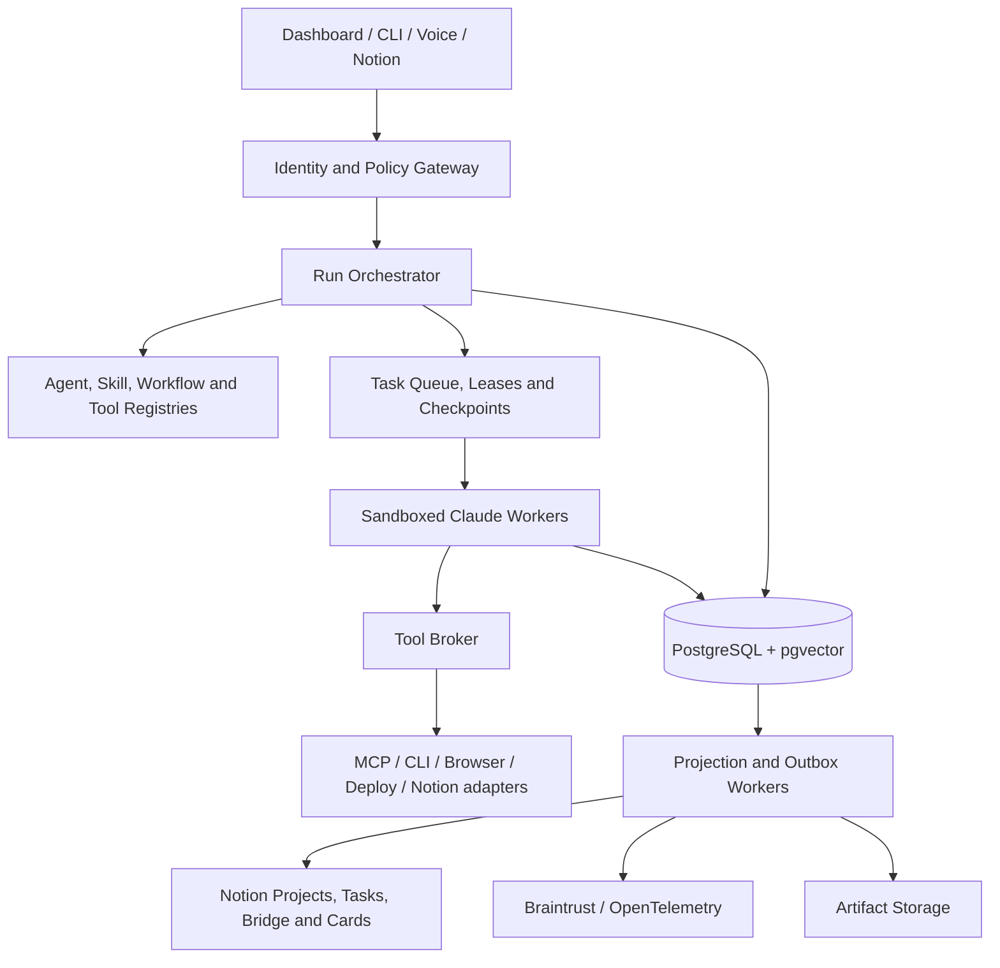

# Target Architecture

## Context

Continuous Claude already provides most of the kernel:

- Agent taxonomy: `.claude/agents/`
- Skills and workflows: `.claude/skills/`
- Lifecycle policy: the canonical hooks manifest and `.claude/hooks/src/`
- Ralph and Maestro state machines: `.claude/skills/ralph/` and `.claude/skills/maestro/`
- Memory: `opc/scripts/core/` with PostgreSQL + pgvector
- Observability: `.claude/docs/architecture/subsystems/braintrust.md`
- Notion collaboration: `.claude/skills/notion-bridge/notion-bridge/`
- Materialized project views: `scripts/project-cards/`

The missing layer is a shared, durable, authenticated control plane.

## Logical architecture



## Planes and ownership

| Plane | Responsibilities | Initial implementation |
|---|---|---|
| Experience | Action catalog, run forms, live timeline, approvals, artifacts, metrics, admin. | React + TypeScript; SSE first, WebSocket only if bidirectional streaming is required. |
| Control | Authentication, RBAC, registry lookup, run creation, state transitions, approvals, policy decisions. | Node/TypeScript HTTP API with schema validation and generated OpenAPI. |
| Execution | Claim tasks, create worktree/sandbox, run Claude adapter, invoke tools, checkpoint, emit events. | Worker service using Claude Agent SDK; local `claude -p` adapter behind the same interface. |
| Data | Runs, tasks, events, memory, evaluations, grants, outbox, idempotency, artifacts metadata. | Existing PostgreSQL 16 + pgvector, migrated through one canonical migration chain. |
| Knowledge/PM | Portfolio, projects, tasks, curated decisions, approval inbox/projections, human-readable results. | Existing Notion databases and Bridge protocol. |
| Observability | Traces, logs, costs, token usage, policy outcomes, evals, SLOs. | Durable telemetry outbox → Braintrust and OpenTelemetry-compatible sink. |

## Source-of-truth matrix

| Entity | Authority | Projection(s) |
|---|---|---|
| Agent/skill/workflow definition | Git commit + content hash | Registry table, dashboard, Notion catalog page |
| Project/task/curated decision/approval inbox | Notion | PostgreSQL reference/cache, dashboard |
| Operational approval state | PostgreSQL | Notion and dashboard projections; both submit versioned commands |
| Run/task/event/lease/idempotency | PostgreSQL | Dashboard, selected Notion status fields |
| Artifact bytes | Object storage or repository | PostgreSQL metadata, Notion link/embed |
| Learning/memory | PostgreSQL + pgvector | Curated Notion knowledge page when promoted |
| Trace/evaluation | PostgreSQL durable record | Braintrust/OTel, dashboard |
| Release/deployment definition | Git | Railway/Vercel deployment state, dashboard |

## Reuse versus replacement

### Reuse

- Agent role files and their capability scoping
- Skill behavior contracts and routing principles
- Ralph lifecycle and `ralph_status` return contract
- Maestro's approval-gated orchestration pattern
- Hook policies as event handlers
- Hybrid memory recall/store services
- Braintrust deterministic dimensions and offline judges
- Notion Bridge child-page handoffs and idempotent tracker mirror
- Project-card content hashing and deterministic render pattern
- Existing sandbox image principles

### Replace or consolidate

- File-scoped Ralph/Maestro state becomes per-run database state.
- Multiple schema bootstraps become versioned migrations and one bootstrap path.
- Drift between `.claude` and `.agents` becomes one canonical package plus generated projections.
- Direct `--dangerously-skip-permissions` jobs become scoped runner capabilities.
- Machine-specific telemetry tasks become portable workers with a durable queue.
- Empty/fragmented MCP catalogs become one tool registry with risk and auth metadata.

## Deployment units

```text
apps/agentic-os-web        operator experience
services/agentic-os-api    identity, registry, runs, approvals, SSE
services/agentic-os-worker Claude runner, sandbox, tool broker
services/agentic-os-sync   Notion/webhook/outbox projections
packages/agentic-contracts shared schemas, events, policy and API types
packages/agentic-registry  Git discovery and content hashing
db/migrations              canonical PostgreSQL changes
```

These are target paths, not authorization to move existing modules during the first slice. Phase 1 should wrap existing behavior before any consolidation refactor.

## Reliability rules

- Database transaction writes the state transition, immutable event, and outbox message together.
- Tool side effects require a stable `operation_id`; adapters record completion before acknowledgement.
- A worker owns a renewable lease, not a permanent task assignment.
- Retrying a step reuses its operation id and checks the adapter receipt.
- Projection failure is retryable and cannot roll back a completed run.
- Cancellation stops new side effects, asks the active runner to stop, and records whether cleanup completed.
- Every run pins exact agent, skill, workflow, policy, and model configuration versions.
