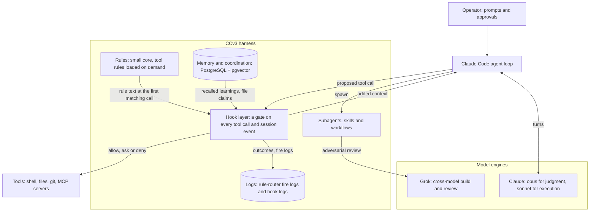

# The layers

[Back to the README](../../README.md) · [All harness pages](README.md)

*Moved from the README on 2026-10-26. The text moved word for word. Edits made while PR 168 was reviewed fix facts that were stale or wrong, and lines that start with "Status on 2026-10-26" are dated notes.*

## The harness shape

The model proposes and the harness decides. Each tool call goes through the hook layer before it
runs. A hook can allow the call, ask the operator, or deny it with a reason. Hooks also add
context: a rule at the first call that needs it, or a stored learning that matches the prompt.
After the call, hooks record outcomes and log lines. The model sees only the context the
task needs, and every decision leaves a record.

## The layers

Each layer below lists what it does, how it works, and one measured result.

### 1. Hooks

Hooks are small programs that Claude Code runs at lifecycle events. They gate tool calls, add
context and record state.

- Source is TypeScript in `.claude/hooks/src/`. `npm run build` in `.claude/hooks` bundles each
  file with esbuild to `.claude/hooks/dist/*.mjs`. Only the bundles run.
- `settings.json` registers hooks on events such as `SessionStart`, `UserPromptSubmit`,
  `PreToolUse`, `PostToolUse`, `PreCompact`, `Stop` and `SessionEnd`.
- A hook speaks to the model only through the `hookSpecificOutput` field. Shared helpers in
  `.claude/hooks/src/shared/output.ts` write that shape.
- A registration has two gates: the `settings.json` matcher and the hook's own `tool_name` check.
  Both must agree, or the hook never acts.

Measured result: 16 hooks exited 0 and never reached the model. They wrote `result` or `message`
fields, which Claude Code does not read. Commit `fd906dd` fixed them.
`scripts/hooks/hook-contract-guard.mjs` now fails on any discarded output. Its current output:
`75 live entries / 67 names, 67 sources scanned, 45 speak the contract, 0 discarded-output`.

Known gap on 2026-10-26: `file-claims.ts` still writes `result` and `message` on its takeover and
degraded-coordination paths (lines 169 to 183), and the guard still reports 0 discarded-output. Those
two warnings may not reach the model.

### 2. Rules

Rules are the instruction text the model reads. CCv3 keeps the always-loaded part small and loads
the rest when it applies.

| Tier | Source in the repo | When it loads |
|---|---|---|
| Core | `.claude/templates/CLAUDE.md.template`, installed as `~/.claude/CLAUDE.md` | Every session |
| On demand | `.claude/rules-ondemand/*.md` and `.claude/rules-ondemand/manifest.json` | At the first matching tool call |
| Path-scoped | `.claude/rules-src/*.md` with `paths:` frontmatter | When matching files are in use |

- The `rule-router` hook (`.claude/hooks/src/rule-router.ts`) reads `manifest.json`. Each entry
  maps a command, agent, skill or MCP tool to one or more rule files.
- Mode `deny-first` refuses the first matching call and gives the rule text as the reason. The
  model then re-plans with the rule in view. This mode is for rules that must change a decision,
  for example a commit message.
- Mode `inject` adds the rule text as context and lets the call run.
- The router logs every fire to `~/.claude/logs/rule-router.jsonl`. It fails open: on an internal
  error, the call runs.
- `scripts/rules/context-budget-guard.mjs` counts the same files Claude Code loads. It fails when
  the total passes `maxChars` in `scripts/rules/context-budget.json`. After a cut, `--repo --tighten`
  lowers `maxChars` to the total plus a 300-char reserve.

Measured result: always-loaded text fell from 153,689 to 18,275 characters. The work landed in
PRs #57 to #61 on 2026-09-24. Commit `ccfc2ef` replaced the old core files and 10 always-loaded
rules with one approved core file.

### 3. Memory

Memory keeps learnings across sessions and recalls them by meaning.

- PostgreSQL 16 with pgvector runs in Docker (`docker/docker-compose.yml`). The schema in
  `docker/init-schema.sql` has four tables: `sessions`, `file_claims`, `archival_memory` and
  `handoffs`.
- `opc/scripts/core/store_learning.py` stores typed learnings, for example `WORKING_SOLUTION`,
  `FAILED_APPROACH` and `USER_PREFERENCE`.
- `opc/scripts/core/recall_learnings.py` runs a hybrid search. It fuses full-text rank and
  pgvector cosine rank with Reciprocal Rank Fusion. A local BGE model makes the embeddings.
- Hooks use memory at set points. `memory-awareness` matches each prompt. `pre-plan-memory` runs
  before plan mode. `agent-recall-injector` briefs each subagent. `session-end-extract` stores
  learnings when a session ends.

Measured result: project-scoped recall never worked from the documented call site. It hashed the
working subdirectory, not the project root, and fell back to global rows without a warning.
Commit `92600ef` fixed the scope. A stored handoff that recall did not return before now ranks
first.

### 4. Agents and coordination

Subagents take delegated work. A coordination layer in PostgreSQL stops parallel sessions from
colliding.

- `.claude/agents/` holds 34 agent definitions (`.md`) and 16 `.json` sidecars. Each definition pins its model:
  `opus` for judgment (planning, review, orchestration) or `sonnet` for execution.
- `scripts/check-agent-model-drift.mjs` fails on a missing model, on `haiku` or `inherit`, or on
  a sidecar that disagrees with its `.md` file.
- Workflow skills such as `/build`, `/fix` and `/explore` chain agents. The `kraken` agent (sonnet)
  implements.
- `scripts/coordination/lane.mjs` lets a session claim a lane (a named unit of work). The claim is
  atomic and has a lease. The `lane-context` hook shows the lane board inside each session.
- The `file-claims` hook runs before each Edit or Write. It denies an edit to a file that another
  live session holds.

Measured result: the file lock failed open under load. The old transport started a Python
process for each check. When that process timed out, callers read "no claim". Commit `d4ecead`
moved the check to a direct `node-pg` connection. `scripts/coordination/load-probe.mjs` measured
6 of 60 intruders let through before, and 0 of 240 after (2026-07-26). The result depends on
machine health, so the probe now measures process-spawn latency first. On a slow machine it
reports INCONCLUSIVE, not a verdict.

### 5. Guardrails

Guardrails stop risky actions before they run.

- `destructive-command-guard` checks Bash and PowerShell calls.
  `.claude/hooks/src/shared/destructive-classifier.ts` classifies the command after it removes
  quoted text. An interactive session gets `ask`. An
  unattended session gets `deny`, because a prompt would hang a headless run.
- `coderabbit-guard` checks the CodeRabbit CLI. It caps runs at 2 per branch and blocks billing,
  key, autofix and install commands. It is built and tested but not registered in live settings
  yet (DW-80).
- `package-install-guard` checks each install command. It checks a typosquat list, a
  known-malicious list that a scheduled job updates, OSV.dev advisories and package age. A package
  under 24 hours old is blocked.
- `plan-mode-approval-gate` asks for approval before a session leaves plan mode.
- `agent-model-guard` never denies: Claude Code rejects an unknown agent type itself. The hook adds a
  "did you mean" hint and a warn row. `no-haiku-enforcer`
  denies a spawn on `haiku`, and any spawn while a global model override is set.
- The `rule-router` `deny-first` mode puts the matching safety rule in front of the model before
  a paid API run, or a commit message.

Measured result: four hooks named PowerShell in their matcher but rejected it at runtime. Only
one of the two gates was widened, so the hooks never ran. Commit `164d86a` fixed all four. The
new test `.claude/hooks/src/__tests__/hook-matcher-runtime-consistency.test.ts` found 7
violations before the fix and 0 after.

### 6. Observability

Observability records what each session did and makes failures visible.

- Braintrust tracing was retired on 2026-09-30. Sessions keep their local transcripts under
  `~/.claude/projects/`. The old tracing code is in `archive/braintrust-2026-10/`.
- `rule-router` logs each fire. A weekly scheduled audit
  (`.claude/scripts/scheduled/scheduled-rule-router-audit.bat`) checks rule precision.
- The `/health-check` skill runs `opc/scripts/health_check.py`. It exercises the real code path
  in 13 categories, such as memory and hooks. It does not only check that files exist.
- `apps/agentic-os/` is a Next.js dashboard over the session and lane tables.
- Scheduled jobs write a `Failed` row before their long step and update it after. A killed run
  leaves a record, not a gap (commits `f43755e` and `4f5f38b`).

Past result (Braintrust tracing, now retired): the session-end trace flush was a blocking HTTPS
call. It took 30.97 s against a 10 s budget, so Claude Code cancelled it and lost the batch.

A second result: `/health-check` reported "PASS: 0 hook registrations all resolve" while 85 hooks
were live. Its parser read only one of two registration shapes. Commit `ee29181` fixed the parser.
